# **TryHackMe Blue Team CTF (Oct 2026): Challenge 3 Day 0**

*A write-up of challenge 3 from the 2026 Oct CTF (TryHackMe) ,also available on Medium: https://medium.com/@wendelwalterleander/tryhackme-blue-team-ctf-oct-2026-challenge-3-day-0-15678e112d30*

## Challenge Description

 <p align="center">
  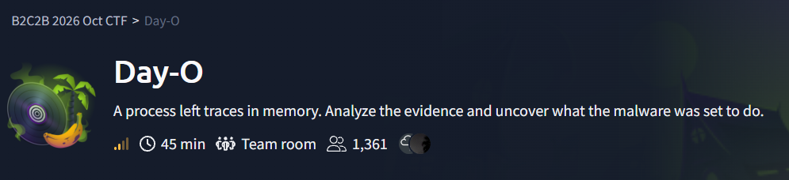
 </p>

**Day-O** is a medium-difficulty, 45-minute team room from the B2C2B 2026 Oct CTF (memory forensics and malware analysis), and its tagline is *A process left traces in memory. Analyze the evidence and uncover what the malware was set to do.* The challenge prompt reads: *Sophia Reyes opened a document review package. The preview froze, and an unexpected executable region appeared in the application's memory. With the workstation's memory preserved, follow the evidence, uncover the hidden payload, and determine what it was prepared to do.*

- **Evidence provided:** a Windows memory dump. In the lab this was `memory.mem` in `~/Desktop/artifacts/`, next to a `symbols` folder (the Windows symbol tables Volatility needs offline) and a `tools` folder.
- **Objectives:** (1) Identify the suspicious process and its associated activity. (2) Examine the memory artifacts for evidence of malicious execution. (3) Investigate the malware and determine how it operates. (4) Recover the information needed to understand the compromise.
- **Analyst note (the only hint):** *A process name tells only part of the story. Compare what was running with what its memory contains, and use the recovered artifacts to support your conclusions.*
- **Analyst workspace:** evidence in `~/Desktop/artifacts/`, tools in `~/Desktop/artifacts/tools/`, with Volatility 3 (`vol`), Ghidra and Speakeasy installed for offline analysis, and a provided Python environment for the bundled modules.

The seven questions were:

1. Which executable contains the suspicious payload?
2. What is the starting virtual address of its private executable memory region?
3. Which file associated with the process also contains the same payload?
4. Which MITRE ATT&CK sub-technique best describes how the payload is stored in the recovered PNG file?
5. Which Windows API does the payload call to launch its next stage?
6. What encryption key does the decoded stage use to decrypt the document cache?
7. What is the flag?

## Brief Summary

There's no exploit to write here, since this one is about finding shellcode that was injected into a legitimate-looking process and following it to what it was built to do. `ReviewClient.exe` (PID 6260), launched from the user's Downloads folder, had a private page of memory at `0x8e0000` that was both writable and executable and not backed by any file, and that page held 32-bit shellcode. The same payload was also carried inside `review-cover.png`, one of the document files the process had open. The shellcode builds the string `WinExec` on the stack and calls `kernel32.WinExec` to start a PowerShell command, and that command contains an AES-256-CBC key that decrypts `review-cache.dat` into a zip file. So the path to the flag went from `malfind` to the shellcode dump, then emulating it, decoding the PowerShell, pulling the cache out of memory and decrypting it, and the flag was inside the zip.

## Methodology & Tooling

**Provided artifacts**

- `memory.mem`, the memory capture
- `symbols/`, the Windows symbol tables for Volatility
- `tools/` with `emulation`, `ghidra_12.1.4_PUBLIC`, `jdk` and `venv`

 <p align="center">
  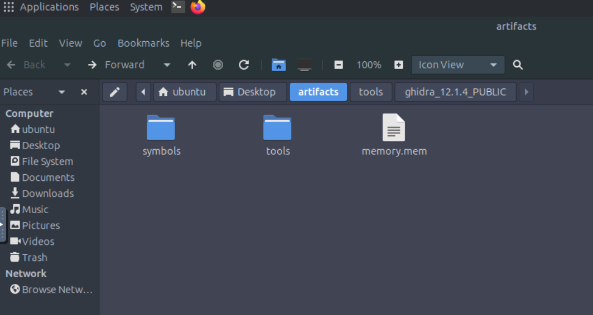
 </p>

 <p align="center">
  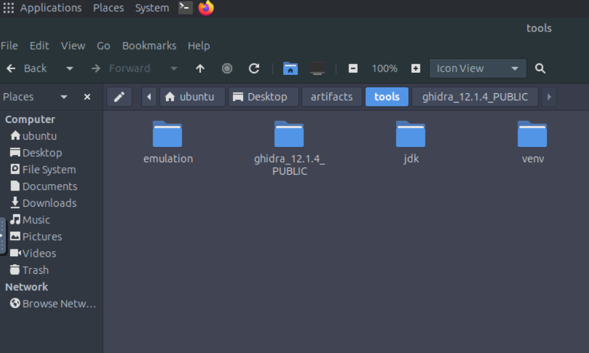
 </p>

**Environment:** the Ubuntu lab VM that TryHackMe provides in the browser, with no AttackBox needed since it's all offline analysis.

**Tools:** Volatility 3 (version 2.28.2, run as `vol` with the local symbols folder), Speakeasy (a Windows shellcode emulator, installed in the provided `venv`), Python, and the usual command line stuff: `grep`, `xxd`, `base64`, `iconv`, `openssl` and `unzip`. Ghidra was available too, but I didn't end up needing it since emulating the shellcode answered everything I needed.

One gotcha before the walkthrough: in Volatility 3, `-o` (the output directory) is a **global option**, so it has to go *before* the plugin name, and putting it at the end gave me `vol: error: unrecognized arguments`.

## Investigation Walkthrough

### Step 1: What kind of memory image is this?

```bash
cd ~/Desktop/artifacts
mkdir -p ~/work/out
vol -s ~/Desktop/artifacts/symbols -f memory.mem windows.info
alias v='vol -s ~/Desktop/artifacts/symbols -f ~/Desktop/artifacts/memory.mem'
```

 <p align="center">
  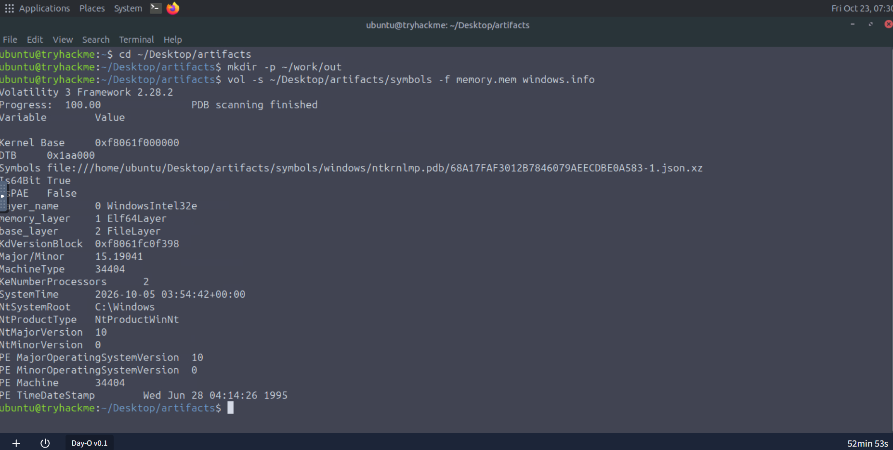
 </p>

It's a 64-bit Windows 10 image (NT 10.0, build 19041) with two processors, captured at **2026-10-05 03:54:42 UTC**, and Volatility found the matching symbol file in the provided folder. The `alias v=...` line is just so I didn't have to retype the long command every time.

### Step 2: Finding the suspicious process (Q1)

I saved the process list, the process tree, the command lines and the `malfind` output into files that I could read at my own pace:

```bash
v windows.pslist  > ~/work/pslist.txt
v windows.pstree  > ~/work/pstree.txt
v windows.cmdline > ~/work/cmdline.txt
v windows.malfind > ~/work/malfind.txt
```

 <p align="center">
  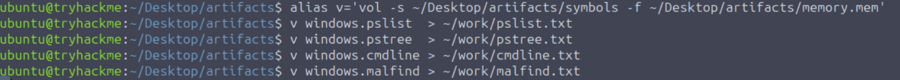
 </p>

The process tree shows a `ReviewClient.e` (PID **6260**, parent 6164) created at 2026-10-05 03:54:18 UTC, and it's flagged as **Wow64**, meaning a 32-bit process on 64-bit Windows. That's worth remembering for later since it decides how to treat the shellcode. A `notepad.exe` (PID 6280) was started by the same parent in the same second, which I didn't dig into.

 <p align="center">
  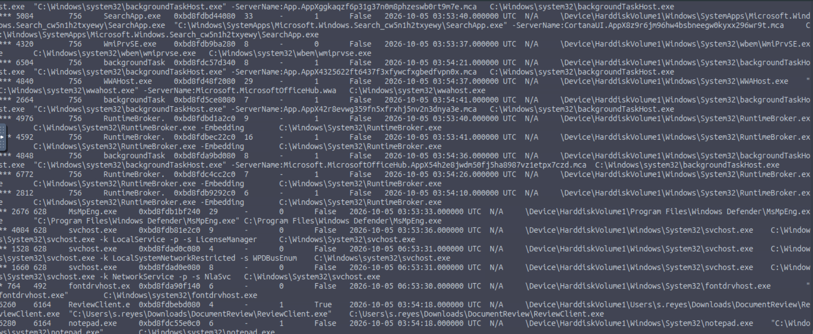
 </p>

This is what the analyst note hinted at. The process name is cut off to `ReviewClient.e` in this output, so the real name comes from the path and command line: `C:\Users\s.reyes\Downloads\DocumentReview\ReviewClient.exe`. An application running out of a Downloads folder is already a bit suspicious, but what really matters is the memory. The answer to **Q1 is `ReviewClient.exe`**.

### Step 3: The executable memory region (Q2)

`malfind` flags memory that is executable but not backed by a file on disk, and it flagged exactly what the brief described:

```
PID 6260  ReviewClient.e  Start VPN 0x8e0000  End VPN 0x8e0fff
Tag VadS  Protection PAGE_EXECUTE_READWRITE  PrivateMemory 1
```

 <p align="center">
  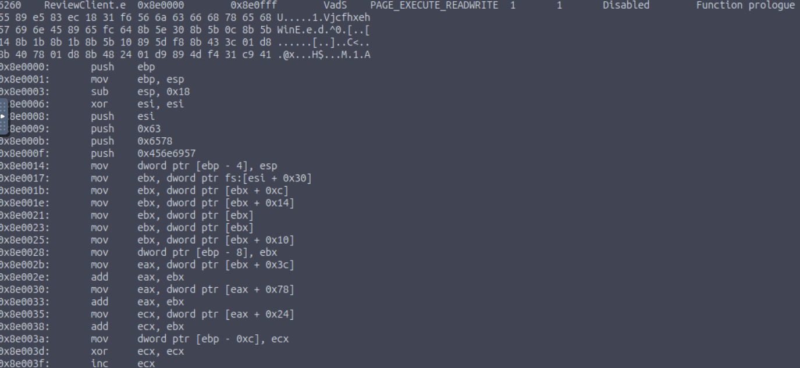
 </p>

I double-checked the region with `vadinfo`:

```bash
v windows.vadinfo --pid 6260 | grep -i -B2 -A8 '0x8e0000'
```

 <p align="center">
  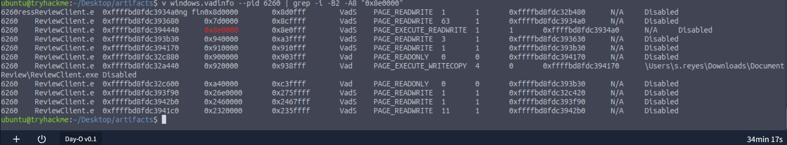
 </p>

The region at `0x8e0000` is one private page with RWX permissions and no mapped file, and next to it the real program image shows up at `0x920000` as a normal file-backed mapping of `ReviewClient.exe`. That contrast is the whole point, because legitimate code lives in file-backed memory and this page doesn't. So **Q2 is `0x8e0000`**.

### Step 4: The files the process had open (Q3 and Q4)

```bash
v windows.handles --pid 6260 | grep -i file
```

 <p align="center">
  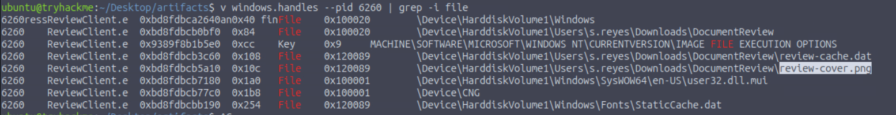
 </p>

Besides system files, the process had two document files open from `C:\Users\s.reyes\Downloads\DocumentReview\`: **`review-cache.dat`** and **`review-cover.png`**. The question describes a PNG that holds the same payload, and the image is the only one that fits, so **Q3 is `review-cover.png`** (and the cache file turns out to matter later).

For Q4, the payload is carried inside the PNG file as an embedded blob, and not hidden in the pixels by some steganographic trick, so the sub-technique I went with was **T1027.009 (Obfuscated Files or Information: Embedded Payloads)**, and the platform accepted it. I'm not going into the exact byte layout of the PNG here.

### Step 5: Looking at the shellcode (Q5)

The `malfind --dump` option writes the region out to a file, and I used `windows.malware.malfind`, which is the plugin name in this Volatility version:

```bash
v -o ~/work/out windows.malware.malfind --pid 6260 --dump
```

 <p align="center">
  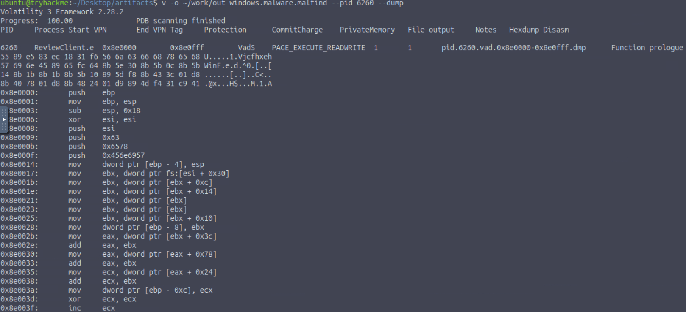
 </p>

The disassembly Volatility prints already tells a story. It starts like a normal function, then pushes a few constants:

```
0x8e0000: push ebp
0x8e0001: mov  ebp, esp
0x8e0003: sub  esp, 0x18
0x8e0006: xor  esi, esi
0x8e0008: push esi
0x8e0009: push 0x63        ; 'c'
0x8e000b: push 0x6578      ; 'xe'
0x8e000f: push 0x456e6957  ; 'WinE'
0x8e0017: mov  ebx, dword ptr fs:[esi + 0x30]   ; the PEB
```

Those three pushes spell **`WinExec`** on the stack, a classic stack string used to hide the API name from simple string searches. The code after that reads the PEB through `fs:[0x30]` and walks its module list and export table, which is the usual way for shellcode to find an API at runtime. That's a strong lead for the answer, but it only shows a name being built, not that it's actually called, so I wanted proof.

The dump is a 4096-byte page with a lot of zero padding, so I stripped the trailing zeros (1345 bytes were left) and ran the shellcode through Speakeasy in raw mode as 32-bit, since the process was Wow64:

```python
d = open('pid.6260.vad.0x8e0000-0x8e0fff.dmp','rb').read().rstrip(b'\x00')
open('sc.bin','wb').write(d); print(len(d), 'bytes')
```

```bash
source ~/Desktop/artifacts/tools/venv/bin/activate
speakeasy -t sc.bin -r -a x86 -o report.json
```
 <p align="center">
  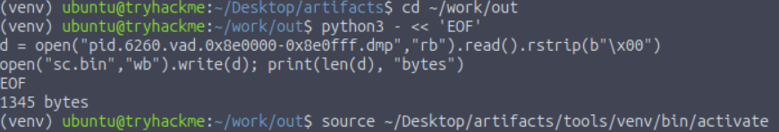
 </p>

 <p align="center">
  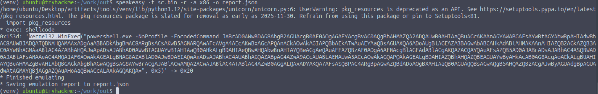
 </p>

Speakeasy logged exactly one API call:

```
0x153d: kernel32.WinExec("powershell.exe -NoProfile -EncodedCommand JABrAD0A...", 0x5) -> 0x20
```

So **Q5 is `kernel32.WinExec`**, called with a PowerShell command line (the `0x5` is the window style, SW\_SHOW) and it returned a success value.

### Step 6: Decoding the next stage (Q6)

The `-EncodedCommand` argument is Base64 over UTF-16LE, so decoding it is just:

```bash
echo '<the encoded command from the WinExec call>' | base64 -d | iconv -f UTF-16LE -t UTF-8
```

 <p align="center">
  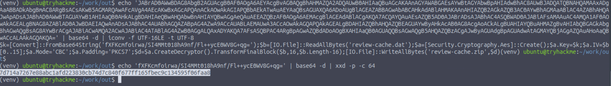
 </p>

What came out was short and very readable:

```powershell
$k=[Convert]::FromBase64String('fXFKcmfoirwa/SI4MMt018hA9nf/Fl++ycE0WV8G+qg=')
$b=[IO.File]::ReadAllBytes('review-cache.dat')
$a=[Security.Cryptography.Aes]::Create(); $a.Key=$k; $a.IV=$b[0..15]
$a.Mode='CBC'; $a.Padding='PKCS7'
$d=$a.CreateDecryptor().TransformFinalBlock($b,16,$b.Length-16)
[IO.File]::WriteAllBytes('review-cache.zip',$d)
```

So the stage reads `review-cache.dat`, uses its **first 16 bytes as the IV**, decrypts the rest with **AES-256-CBC (PKCS7)**, and writes the result out as `review-cache.zip`. The key is a Base64 string that decodes to 32 bytes, and converting it to hex:

```bash
echo 'fXFKcmfoirwa/SI4MMt018hA9nf/Fl++ycE0WV8G+qg=' | base64 -d | xxd -p -c 64
```

gives **`7d714a7267e88abc1afd223830cb74d7c840f677ff165fbec9c134595f06faa8`**, which is the answer to Q6 (I submitted the hex form and it was accepted).

### Step 7: Recovering the cache and the flag (Q7)

The payload only *decrypts* the cache on the victim, so I had to do that myself, which meant first getting `review-cache.dat` out of memory. My first attempt used `windows.dumpfiles --physaddr` with the offset from the handles output, but it only printed an empty table, so I went back to dumping everything the process had open:

```bash
v -o ~/work/out windows.dumpfiles --pid 6260
```

 <p align="center">
  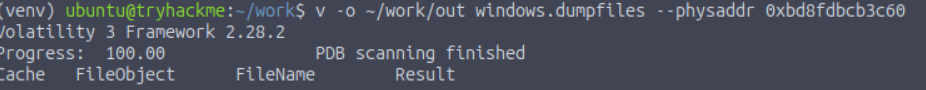
 </p>

That produced several files per document, and the useful one for the cache was the `DataSectionObject` file for `review-cache.dat` (4096 bytes, since memory is stored in pages and the real file is smaller with zero padding at the end). So I stripped the trailing zeros, rounded up to a multiple of 16 for AES (which gave **528 bytes**), split off the IV, and decrypted with the exact settings from the script:

```bash
f=<path of the dumped review-cache.dat DataSectionObject file>
size=$(python3 -c "d=open('$f','rb').read().rstrip(b'\x00'); print((len(d)+15)//16*16)")
head -c $size "$f" > enc.bin
iv=$(head -c 16 enc.bin | xxd -p)
tail -c +17 enc.bin > cipher.bin
openssl enc -d -aes-256-cbc -K 7d714a7267e88abc1afd223830cb74d7c840f677ff165fbec9c134595f06faa8 -iv $iv -in cipher.bin -out review-cache.zip
file review-cache.zip
unzip -l review-cache.zip && unzip review-cache.zip -d cache_out
grep -rho 'THM{[^}]*}' cache_out
```

 <p align="center">
  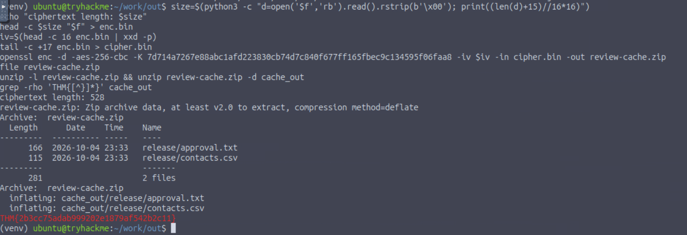
 </p>

```
ciphertext length: 528
review-cache.zip: Zip archive data, at least v2.0 to extract, compression method=deflate
  166  2026-10-04 23:33  release/approval.txt
  115  2026-10-04 23:33  release/contacts.csv
THM{2b3cc75adab999202e1879af542b2c11}
```

A valid zip coming out is also my sanity check that the key, IV and trimmed length were all right, since a wrong key would just give garbage. The archive holds `release/approval.txt` and `release/contacts.csv`, and the `grep` hit is the flag (I used `-h`, so it doesn't say which of the two files it was in).

### What the malware was set to do

The shellcode injected into `ReviewClient.exe` hides its API name on the stack, resolves `WinExec` on its own, and launches PowerShell with an encoded command. That command holds a hard-coded AES key and unpacks the document cache (`review-cache.dat`) into a zip containing a release approval and a contacts list. What stuck with me is how much of this sat in plain view once I looked at the right 4 KB page, since the whole malicious logic was a short stack string and one API call, and thus most of the work was just finding the right page and the right file.

## Flag

 <p align="center">
  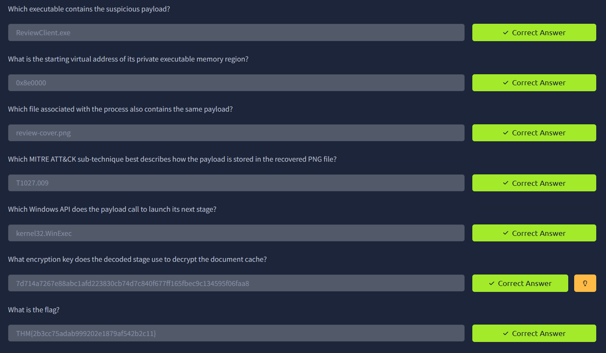
 </p>

```
THM{2b3cc75adab999202e1879af542b2c11}
```

| # | Question | Answer |
| --- | --- | --- |
| 1 | Executable containing the suspicious payload | `ReviewClient.exe` |
| 2 | Starting virtual address of its private executable region | `0x8e0000` |
| 3 | File associated with the process that also contains the payload | `review-cover.png` |
| 4 | MITRE ATT&CK sub-technique for how the payload is stored in the PNG | `T1027.009` |
| 5 | Windows API called to launch the next stage | `kernel32.WinExec` |
| 6 | Encryption key used by the decoded stage | `7d714a7267e88abc1afd223830cb74d7c840f677ff165fbec9c134595f06faa8` |
| 7 | Flag | `THM{2b3cc75adab999202e1879af542b2c11}` |
