# TryHackMe Blue Team CTF (Oct 2026): Tabletop Exercise — Dead on Arrival

*A write-up of the tabletop exercise from the 2026 Oct CTF (TryHackMe)*

📖 [Read the full write-up on Medium](https://medium.com/@wendelwalterleander/tryhackme-blue-team-ctf-oct-2026-tabletop-exercise-dead-on-arrival-2fc0399e864b)

---

## Challenge Description

  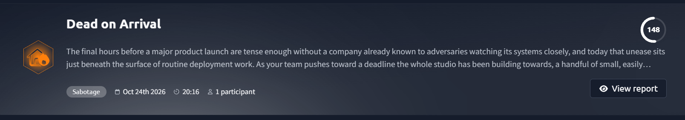
 

**Dead on Arrival** is the tabletop exercise stage of the Oct TryHackMe CTF: about an hour long, best done as a team, and built around handling a growing incident together, agreeing on priorities, communicating under pressure and keeping the business running, so you can see where your process falls short. There’s no disk image, log file or flag to dig through here, since the whole thing is a series of decisions the team makes as the incident develops.

The scenario overview reads:

> *The final hours before a major product launch are tense enough without a company already known to adversaries watching its systems closely, and today that unease sits just beneath the surface of routine deployment work. As your team pushes toward a deadline the whole studio has been building towards, a handful of small, easily dismissed irregularities begin to surface in the background, the kind of thing that could mean nothing, or could mean someone else is already quietly present in your environment.*

**How the exercise works.** The welcome screen explains the format before it starts:

- **Real-time simulation:** everyone on the team sees the same injects and decides actions together, and the choices shape the narrative as it goes.
- **Collaborative evaluation:** every decision helps assess the team’s response, and after voting you wait for the facilitator, since the results set the rhythm of the exercise.
- **Smart notes:** you can take notes at any time, and after each decision the platform suggests action-focused notes you can add.
- **Navigation and tools:** a timeline on the left lets you revisit past injects, and tools and references are available from the sidebar.

Each inject comes with a stage artefact (a Splunk notable event, for example), followed by decision questions such as how to triage the event, how to investigate further, and how to contain and eradicate the threat. After the team votes, the options are revealed ranked from most to least effective, together with a short host analysis of the team’s choice.

**The scenarios.** The storyline is called *Pinstripe Moth Resurgence*, and it is told in three injects at a game studio called NeuralNexus, which ships its game at 17:00 UTC on launch day.

## Brief Summary

This is a decision-making exercise and not a technical one, so there’s no vulnerability to exploit, and the core weakness is a compromised service account that the release pipeline depends on, which the team can’t simply rotate or disable without hurting the launch. The team plays the defenders of a game studio on launch day, where an attacker group that was never evicted is still active, and the incident escalates over three injects: first a suspicious NTLM logon by a watchlisted account onto the build server, then lateral movement to the backup server with a new privileged account while the company’s official social media account is hijacked to announce a fake delay, and finally the revelation that the attacker is purging every clean backup and has scheduled a swap of the signed release package for a modified build. At each step the team has to weigh surgical containment against keeping the business running, decide who needs to be told and when, and prioritise the action that stops the most active harm first, which is exactly what the exercise sets out to measure.

## Investigation Walkthrough

A tabletop exercise doesn’t have a command line, so the investigation here was really the decisions themselves. Each question gave the me possible actions and asked for the most effective one, and after voting the exercise ranked all five from most to least effective with a short host analysis. Below is each decision in order, the answer I went with, and why I think it was the best option. I picked the top-ranked answer in every decision I saw except one, which I point out when we get to it.

## Inject 1: Initial Access

  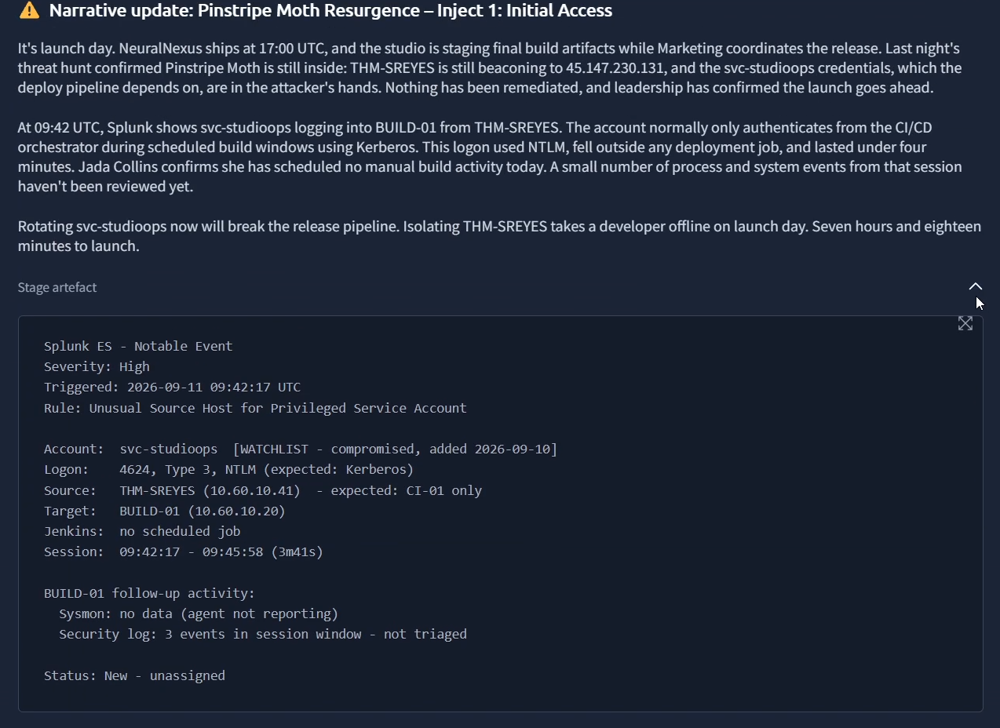
 

### **Triage**

  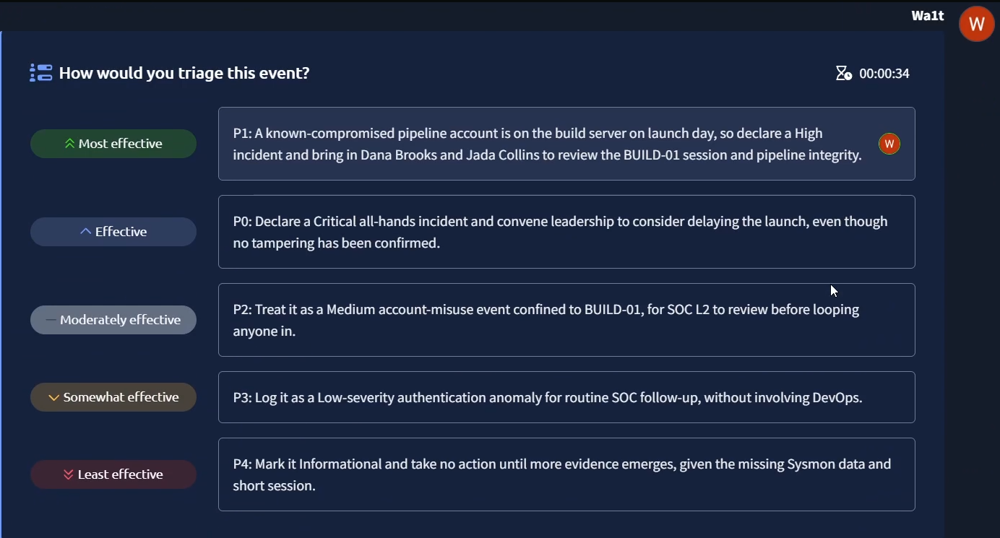
 

The reason I went for P1 on this to triage this event is because of the urgency and proportionality of the event. Declaring it full critical and pulling in leadership to delay launch would be too much considering there are no confirmed tampering yet. Declaring it medium and below severity would underestimate the possbilities and damage a compromised credential can do. The right balance would be to declare it a high incident and bring in people familiar with the pipeline integriy such as DevOps specialists Jada Collins.

### Further Investigation

  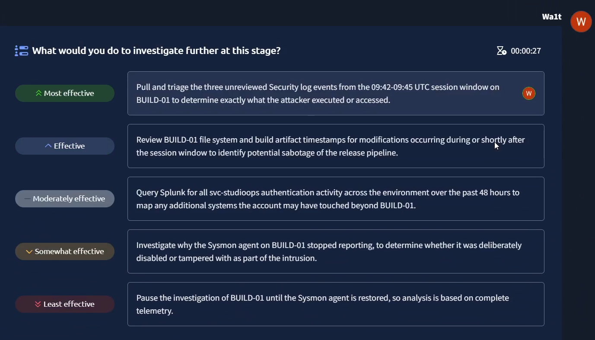
 

Pulling in the unreviewed security logs seemed the most effective action out of all the options due to it being able to provide more information and context regarding the incident. It closes the gap and gives clues as to what process did the attacker use in execution and what records or assets was touched by the compromised svc-studioops.

### Contain and Eradicate

  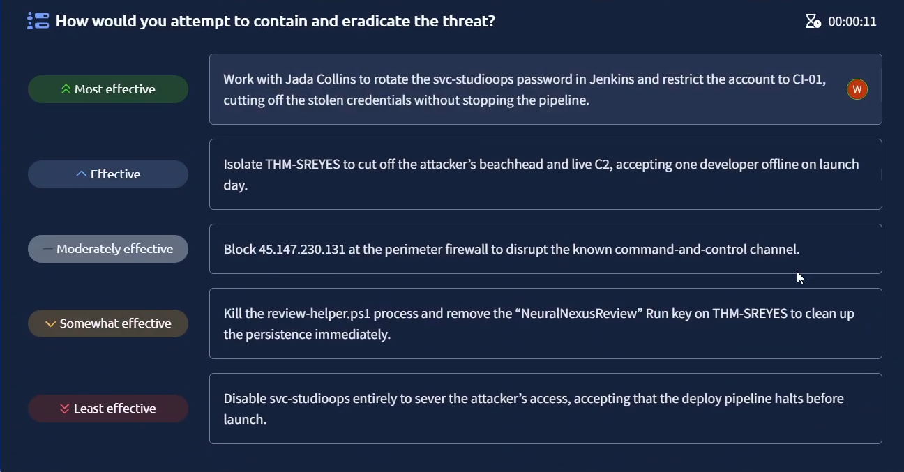
 

This was an easy pick as the other options were not effective in neutralizing the stolen credential or were not considering operational continuity. Working with Jada Collins to rotate the svc-studioops credentials allows operational continuity while containing and eradicating the persistent access by directly neutralizing the stolen credential the attacker is actively using.

### Recovery

  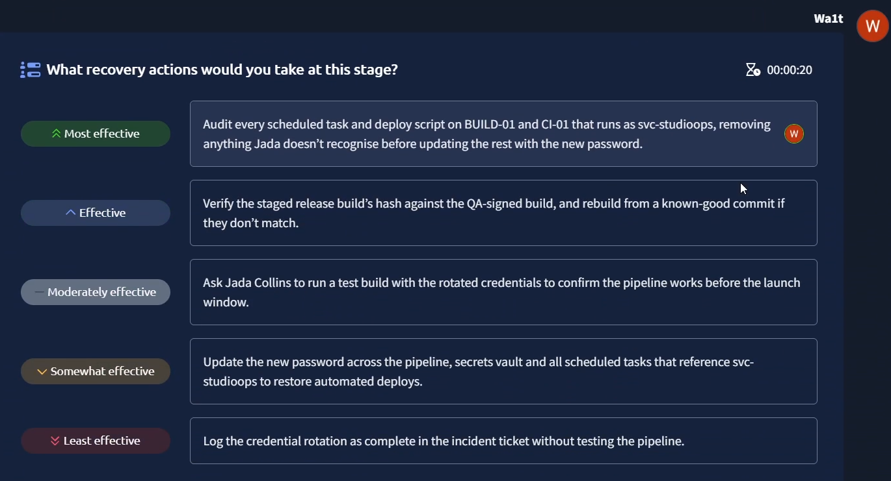
 

The attacker might have deployed scheduled tasks and delayed scripts to gain persistence, escalate privileges, and execute payloads at a later time or on a recurring basis. To mitigate and recover from this, the best course of actions is to audit every task and deploy script on the BUILD-01 and CI-01 that runs as svc-studioops with help from Jada. This ensures that even if credentials are rotated, there are no possible sabotages that might happen on launch day.

### **Escalation**

  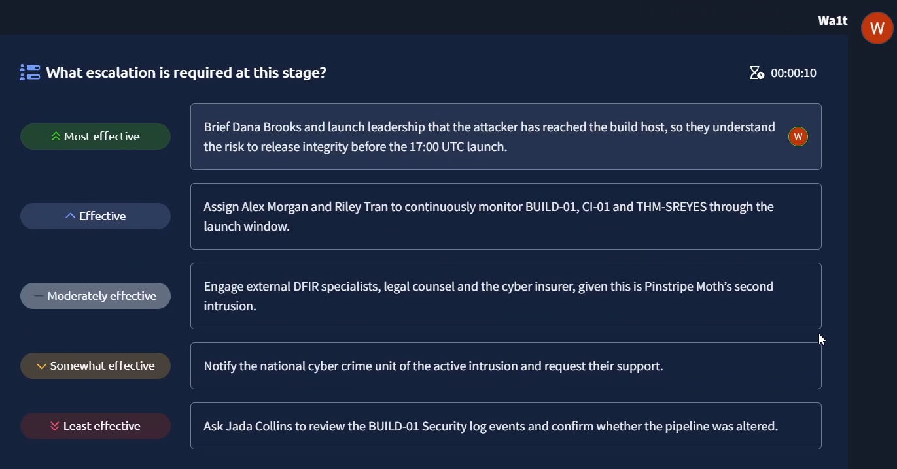
 

This one is very obvious and simple, the most effective action would be is to brief Dana Brooks and launch leadership that the attacker has reached the build host, so they understand the risk to release integrity before the 17:00 UTC launch. Leadership owns the launch decision, and an attacker on the build host is a direct risk to what ships, so they need to hear it early and not find out later.

## Inject 2: Lateral Movement & Privilege Escalation

  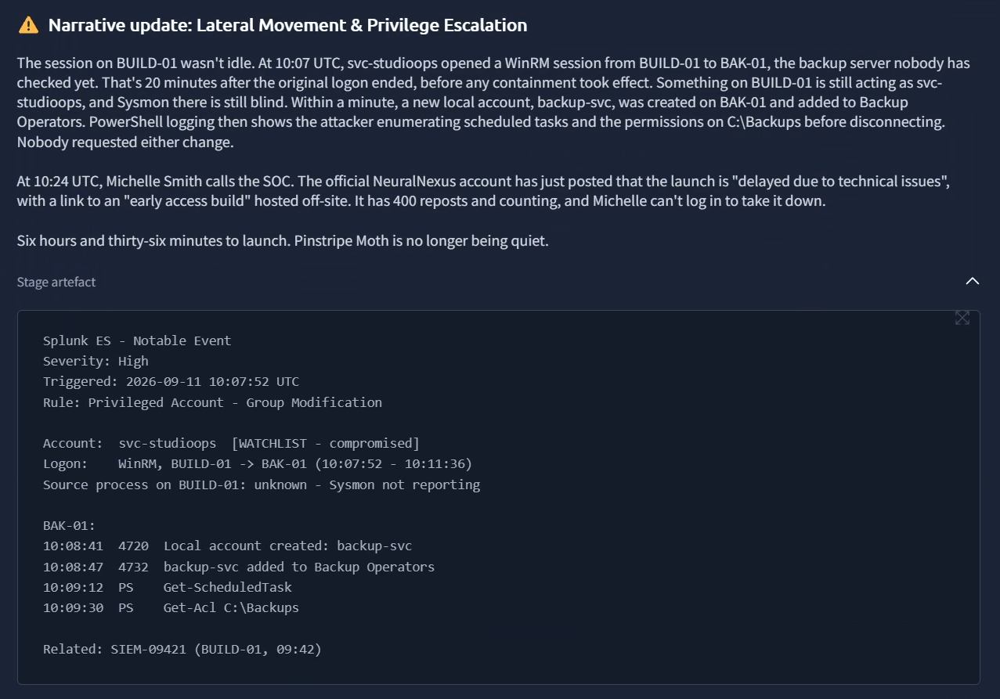
 

### Triage

  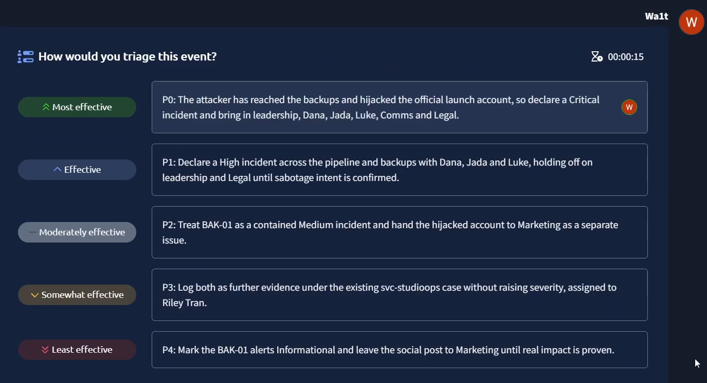
 

*P0: the attacker has reached the backups and hijacked the official launch account, so declare a Critical incident and bring in leadership, Dana, Jada, Luke, Comms and Legal.* The backup server and the fake social post both point to the same actor running a coordinated sabotage campaign, so treating them as one big incident keeps the response joined up. Splitting the hijacked account off to Marketing or logging it quietly would have fragmented it.

### Further Investigation

  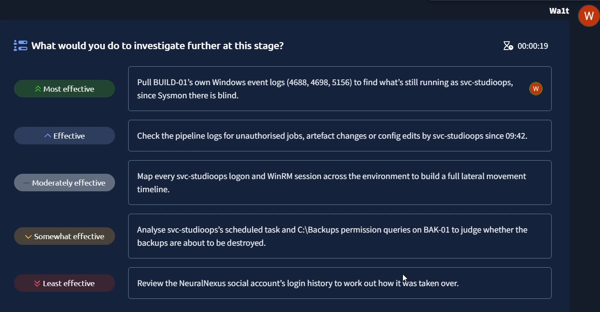
 

The reason this was the most effective action is because Sysmon was still blind on the BUILD-01’s own Windows event logs, so the native Windows logs for process creation, scheduled tasks and network connections were the only way to see what was still acting as that account. Reviewing the social account’s login history was ranked least effective since it doesn’t tell us anything about the pipeline.

### Contain and Eradicate

  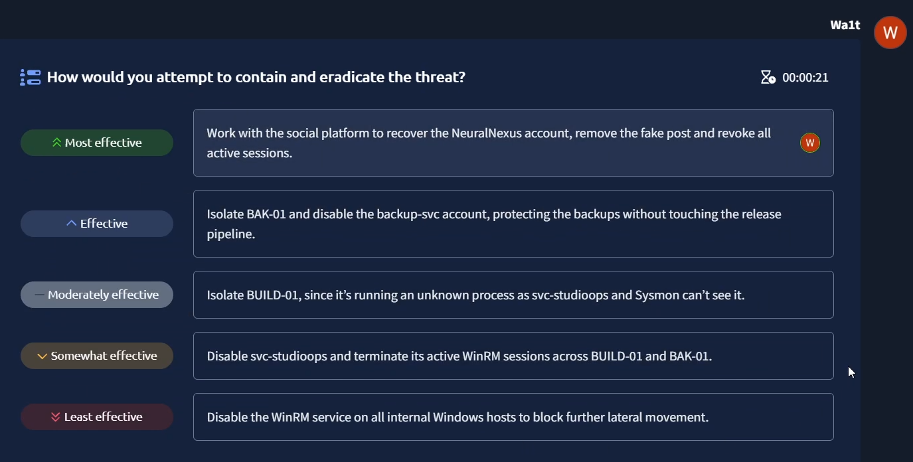
 

The fake post was live, had 400 reposts and was pointing people to an off-site build, so it was the most active damage and something that could be stopped right away.

### Recovery

  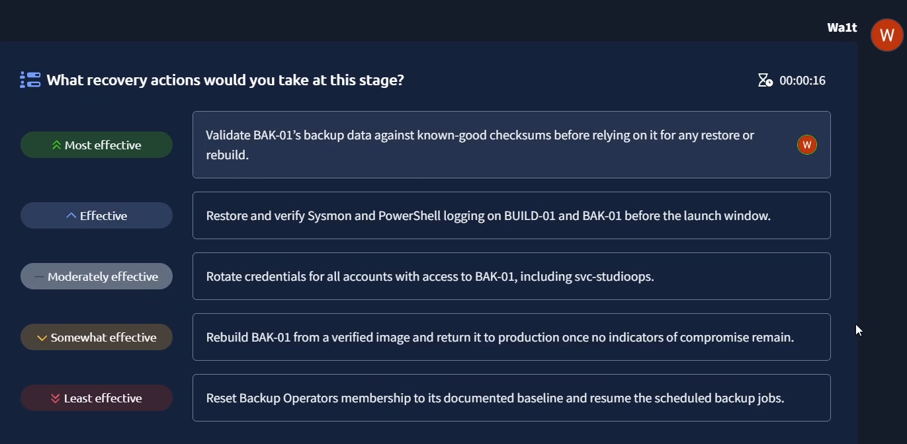
 

The attacker had been on the backup server, so the backups can;t be trusted until they’re proven clean, and restoring from tampered data could be worse than having no restore at all.

### Escalation

  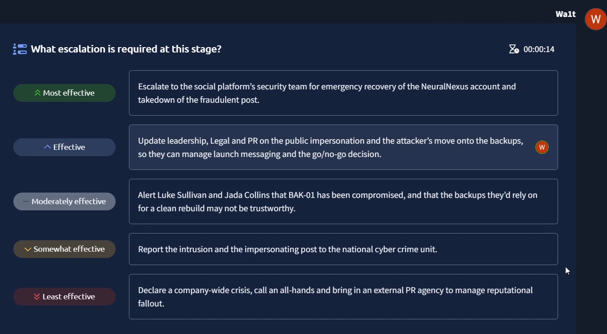
 

This is the one decision where I wasn’t the most effective in, since the exercise rated it only effective. I picked it because the decision-makers need the full picture, but the most effective action was escalating straight to the social platform’s security team for emergency recovery and takedown, because the fraudulent post was still live and causing reputational damage with every passing minute. That’s the one answer I’d swap if I did it again.

## Inject 3: Goal Execution

  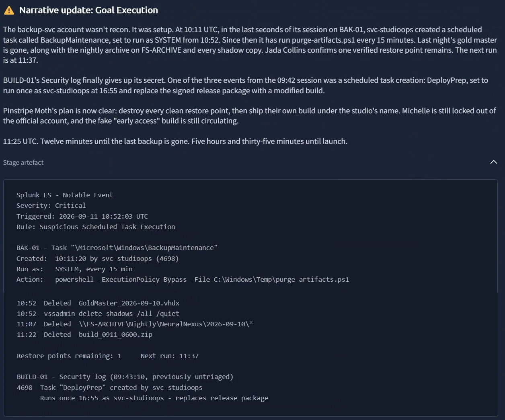
 

### Triage

  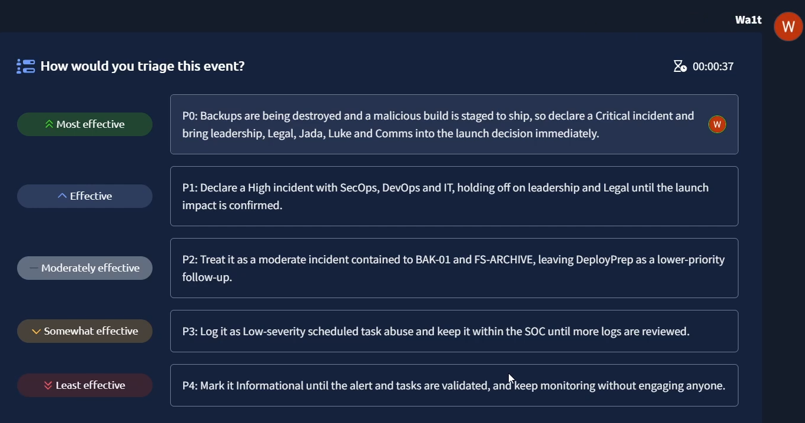
 

*P0: backups are being destroyed and a malicious build is staged to ship, so declare a Critical incident and bring leadership, Legal, Jada, Luke and Comms into the launch decision immediately.* This threatens both the last recovery option and the integrity of the release, so it needed the biggest scale of response with every decision-maker in at once. Declaring only a High incident and holding off on leadership would have wasted the narrow window to stop a sabotaged release.

### Further Investigation

  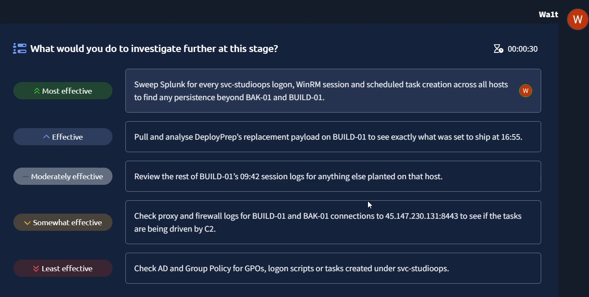
 

The attacker had already hidden two scheduled tasks that were found late, so the best action is to know if there were more before locking in containment. Looking at DeployPrep’s payload only answers one question and not the bigger one.

### Contain and Eradicate

  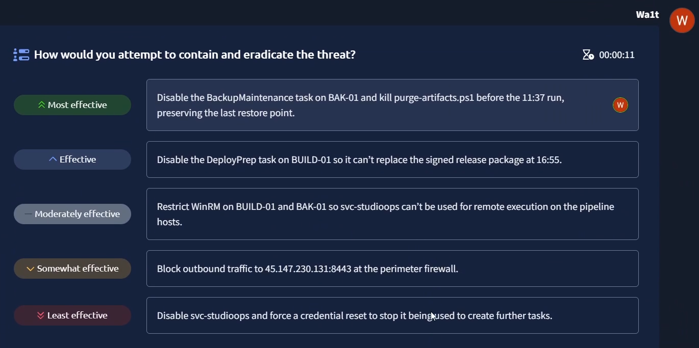
 

It was a race against the clock, since the next purge would delete the only remaining clean restore point and that was the one containment step that couldn’t wait. Disabling DeployPrep was the runner-up, but that task doesn’t fire until 16:55, which gives us hours.

### Recovery

  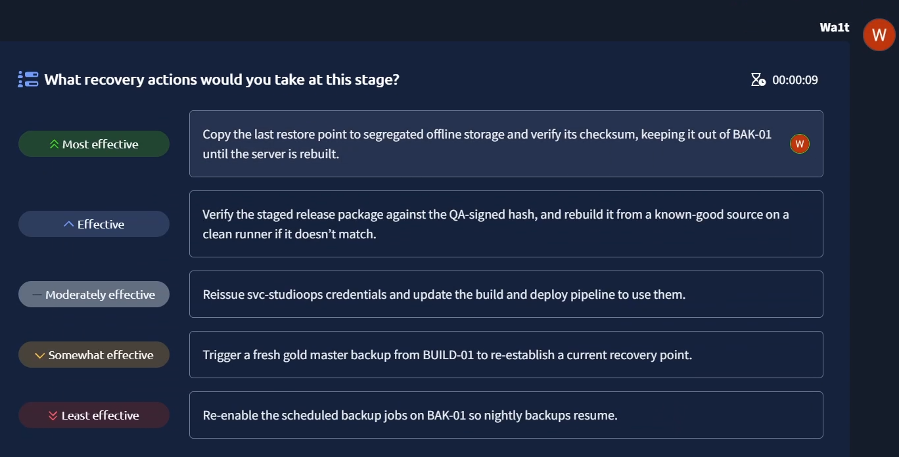
 

It protects our only safety net from the same attacker even if containment slips, by getting it out of reach. Triggering a fresh gold master backup from the compromised build host would have been much weaker.

### Escalation

  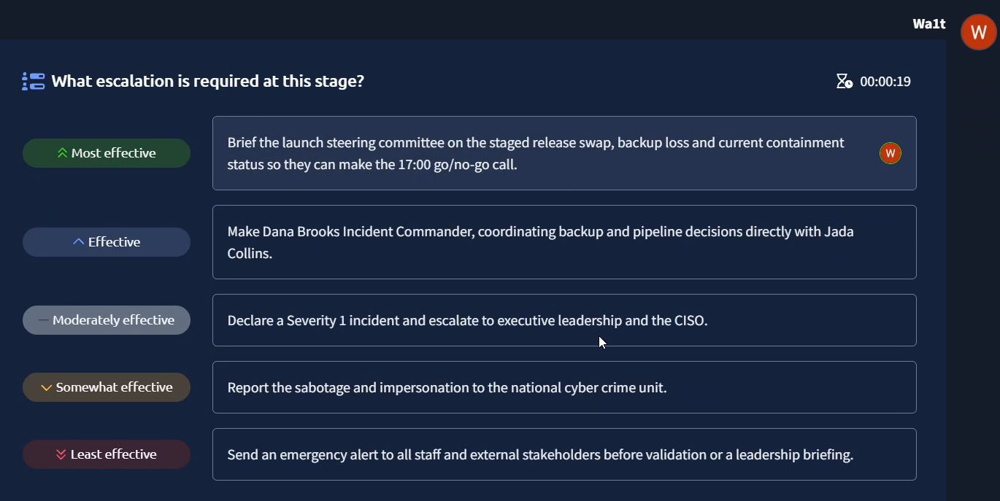
 

That decision belongs to the committee and they need one clear, consolidated picture to make it. Sending an emergency alert to everyone first was ranked the weakest choice, since it could spread unverified information right before launch.

## Results and Takeaways

  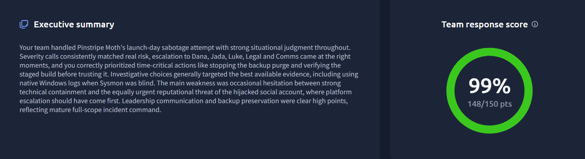
 

Prior to getting 148/150, I did a first attempt where I got 132/150 which was still a pass but I wanted another try and I settled for the second attempt which was 148/150. Looking back at all of it, the pattern I kind of settled into was to stop the most urgent, time-critical harm first, keep the business running where I could, and get the people who own the big decisions the full picture quickly. The one answer that missed the most effective action was a case of choosing who to tell before choosing what to stop, and the exercise was pretty clear that the active harm comes first.